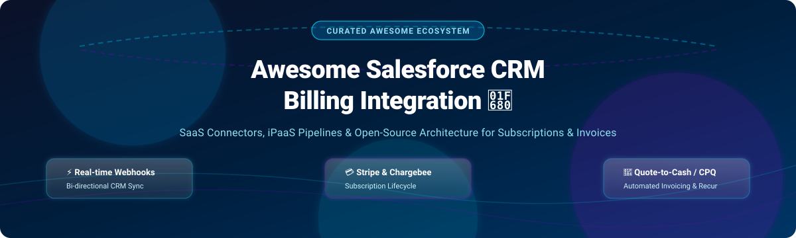

# ⚡ Awesome Salesforce CRM Billing Integration 💳

  <strong>A curated directory of top-tier Salesforce CRM Billing Integration platforms, SaaS/iPaaS enterprise connectors, and open-source payment & invoicing architectures.</strong>

  <em>Streamline subscription lifecycle management, recurring revenue sync, quote-to-cash workflows, dunning pipelines, and invoice-to-cash accounting between Salesforce and modern billing engines.</em>

---

## 📑 Table of Contents

- [🌐 Sector Overview & Market Dynamics](#-sector-overview--market-dynamics)
- [🟦 SaaS / Hosted Platforms](#-saas--hosted-platforms)
- [🟩 Open-Source Software](#-open-source-software)
- [📊 Comparison at a Glance](#-comparison-at-a-glance)
- [📈 Star History](#-star-history)
- [💖 Support & Sponsorship](#-support--sponsorship)
- [🤝 Contributing](#-contributing)
- [📄 License](#-license)

---

## 🌐 Sector Overview & Market Dynamics

The global subscription billing management market was estimated between **$7.2B and $7.88B in 2024**, rising toward **$9.2B+ in 2025** at a compound annual growth rate (CAGR) of ~14–17%, underpinned by a broader recurring digital payments volume exceeding $160B+. Over 60% of modern enterprises actively integrate their recurring billing engines directly with cloud CRM suites like Salesforce to unify quote-to-cash operations.

The sector is **moderately fragmented**: mega-cap enterprise cloud ecosystems (Salesforce Revenue Cloud, MuleSoft, SAP) dominate high-end, complex corporate architectures, while specialized subscription powerhouses (Chargebee, Stripe Billing, Zuora) and agile modern iPaaS platforms (Boomi, Workato, Celigo) vigorously capture mid-market and high-growth SaaS segments through flexible low-code orchestration.

---

## 🟦 SaaS / Hosted Platforms

Below is an overview of commercial, cloud-hosted Salesforce CRM Billing Integration and iPaaS solutions, ranked in descending order of vendor scale (company valuation and annual revenue).

| Solution | Vendor Scale (Valuation / Revenue) | Key Focus & Billing Capabilities | Starting Tier Pricing | Free Tier Limits / Free Trial |
|---|---|---|---|---|
| **[MuleSoft Anypoint Platform](https://www.mulesoft.com)** | **$6.5B acquisition valuation** (Salesforce unit; Salesforce $34B+ revenue) | Enterprise iPaaS offering certified Salesforce connectors, DataWeave transformations, and robust API-led connectivity across ERPs, Chargebee, and Stripe. | Starts at **$2,000/month** (entry Integration package, billed annually) | **30-day free trial**; evaluation only, no production deployments |
| **[Workato](https://www.workato.com)** | **$5.7B valuation** (~$150M ARR) | Enterprise integration & automation recipes connecting Salesforce CRM with billing systems, syncing invoices, subscriptions, and customer accounts. | Starts at **$75/month** (Pro plan base) | **Free tier forever** (one-time allotment of 50,000 credits for workflow testing) |
| **[Boomi](https://boomi.com)** | **$4.0B acquisition valuation** (~$500M ARR) | Cloud-native iPaaS with pre-configured Salesforce connectors, drag-and-drop mappings, master data governance, and high-volume billing endpoints. | Starts at **$99/month** (Pay-as-you-go + $0.05/message) | **30-day free trial**; full platform access, self-service sandbox without limits |
| **[Chargebee for Salesforce](https://www.chargebee.com)** | **$3.5B valuation** (~$202M ARR) | Native bidirectional sync for Salesforce accounts, opportunities, subscriptions, metered billing, multi-decimal pricing, and sync health dashboards. | **$0/month** (Starter Plan for early stage) / **$599/month** (Performance Plan) | **Free forever up to $250,000** cumulative lifetime billing (0.75% overage fee thereafter); or standard 14-day free trial |
| **[Chargebee CPQ for Salesforce](https://www.chargebee.com/cpq/)** | **$3.5B valuation** (~$202M ARR) | Native quoting inside Salesforce CRM with ramped pricing, multi-frequency billing, RevOps approvals, and direct quote-to-customer creation. | **$0/month** (CPQ Lite) / Custom pricing for full enterprise CPQ | **Free tier forever for first 50 quotes** generated in CPQ Lite; standard 14-day full trial |
| **[Celigo integrator.io](https://www.celigo.com)** | **~$800M+ valuation** (~$100M ARR) | iPaaS integration platform with pre-built Salesforce connectors, order-to-cash automations, and billing marketplace flows. | Starts at **$600/month** (Standard Edition entry tier) | **Free plan forever** (capped at 1 active integration flow and 2 endpoints); plus **30-day free trial** with unlimited flows |
| **[Jitterbit Harmony](https://www.jitterbit.com)** | **~$150M+ valuation** (~$105M ARR) | Unified iPaaS connecting Salesforce CRM with ERPs, accounting packages, and billing platforms via pre-built connectors and low-code orchestrations. | Starts at **$1,000/month** (Standard Tier, annual contract) | **14-day free trial**; non-production evaluation sandbox (data retained only upon paid upgrade) |

---

## 🟩 Open-Source Software

Community-driven, open-source projects, developer SDKs, and native Salesforce Apex architectures for billing, payment gateways, and subscription management. Ranked in descending order of GitHub_Stars_Count.

### 🌟 Repositories by Popularity

* **[Twenty (twentyhq/twenty)](https://github.com/twentyhq/twenty)** 
  * **Stack:** TypeScript, NestJS, React, PostgreSQL | **License:** AGPL-3.0
  * **Overview:** A modern, self-hostable open-source CRM alternative to Salesforce with built-in billing, invoicing, and subscription processing capabilities via Stripe.
  * **Ideal For:** Teams seeking a modern CRM codebase with native recurring billing logic out of the box without vendor lock-in.

* **[stripe-salesforce-ai-context (stripe/stripe-salesforce-ai-context)](https://github.com/stripe/stripe-salesforce-ai-context)** 
  * **Stack:** Markdown, JSON, Stripe Context Prompts | **License:** MIT / Open
  * **Overview:** Stripe's official AI-native developer context repository for accelerating custom Stripe-to-Salesforce billing integrations, webhook architectures, and automated CRM workflows.
  * **Ideal For:** Developers building customized Apex and Node.js sync pipelines connecting Stripe Billing with Salesforce.

* **[SalesforceLabs Easy-PDF (SalesforceLabs/Easy-PDF)](https://github.com/SalesforceLabs/Easy-PDF)** 
  * **Stack:** Apex, Visualforce | **License:** SalesforceLabs Open Source
  * **Overview:** Open-source PDF invoice and quote generator for Salesforce. Enables one-click invoice rendering from standard Opportunities, Orders, or custom billing objects.
  * **Ideal For:** Organizations seeking no-cost, declarative/Apex invoice PDF generation directly within their Salesforce org.

* **[ApexMerchant (cnaccio/ApexMerchant)](https://github.com/cnaccio/ApexMerchant)** 
  * **Stack:** Apex (Salesforce native) | **License:** MIT
  * **Overview:** A multi-gateway payment processing library for Salesforce and Force.com supporting Stripe, Authorize.Net, and PayPal for real-time transaction handling.
  * **Ideal For:** Native Salesforce apps requiring programmatic card charging, transaction logging, and gateway routing.

* **[Stripe-Apex-Toolkit (aslambari/Stripe-Apex-Toolkit)](https://github.com/aslambari/Stripe-Apex-Toolkit)** 
  * **Stack:** Apex | **License:** MIT
  * **Overview:** Comprehensive Apex wrapper library for Stripe REST APIs, providing strongly typed classes for Stripe Customers, Invoices, Subscriptions, and PaymentIntents.
  * **Ideal For:** Salesforce engineers writing custom billing sync logic without having to construct raw HTTP JSON payloads manually.

* **[Dunning and Collections for Salesforce Billing (SalesforceLabs/Dunning-and-Collections-Salesforce-Billing)](https://github.com/SalesforceLabs/Dunning-and-Collections-Salesforce-Billing)** 
  * **Stack:** Apex, Lightning Components | **License:** SalesforceLabs Open Source
  * **Overview:** Reference architecture and automated workflows for managing overdue invoices, late payment notifications, automated dunning cadences, and customer collections.
  * **Ideal For:** Salesforce Billing users needing out-of-the-box collections management without custom development.

* **[SalesforceBillingPaymentGatewayMockAdapterReference (forcedotcom/SalesforceBillingPaymentGatewayMockAdapterReference)](https://github.com/forcedotcom/SalesforceBillingPaymentGatewayMockAdapterReference)** 
  * **Stack:** Apex | **License:** BSD-3-Clause
  * **Overview:** Official reference implementation from Salesforce demonstrating how to construct custom payment gateway adapters for Salesforce Billing.
  * **Ideal For:** FinTech engineers developing custom payment gateway connectors (Adyen, Stripe, Checkout.com) into Salesforce Billing.

* **[Delivery-Hub (Nimba-Solutions/Delivery-Hub)](https://github.com/Nimba-Solutions/Delivery-Hub)** 
  * **Stack:** Apex, Lightning Web Components (LWC) | **License:** Open Source
  * **Overview:** Salesforce-native delivery pipeline providing one-click PDF invoice generation from logged work hours and bidirectional invoice/payment sync with QuickBooks.
  * **Ideal For:** Service agencies and consultancies wanting automated invoicing without external subscription middleware.

* **[salesforce-stripe-payment-processing (Cloud-Code-Academy/capstone-projects-salesforce-stripe-payment-processing-integration-developer-capstone-stripe)](https://github.com/Cloud-Code-Academy/capstone-projects-salesforce-stripe-payment-processing-integration-developer-capstone-stripe)** 
  * **Stack:** Apex, Webhooks, Queueable Apex | **License:** Open Source
  * **Overview:** Apex-native Stripe integration handling inbound webhooks (`invoice.payment_succeeded`, `subscription.updated`) and outbound calls with Custom Metadata secrets.
  * **Ideal For:** Production-tested blueprints for bi-directional Stripe webhook handling and event dispatching inside Salesforce orgs.

* **[SFDC-MaxioAB-Integration (caseydunlap/SFDC-MaxioAB-Integration)](https://github.com/caseydunlap/SFDC-MaxioAB-Integration)** 
  * **Stack:** Python (AWS Lambda), Apex | **License:** Open Source
  * **Overview:** Serverless AWS Lambda pipeline integrating Salesforce closed-won opportunities with Maxio Advanced Billing (AB) and Maxio Core, persisted to Snowflake.
  * **Ideal For:** High-volume B2B teams running consumption billing on Maxio requiring serverless queue processing.

---

## 📊 Comparison at a Glance

| Solution | Model | Technology Stack | Supported Billing Systems | Sync Direction | Self-Hosted Option | Best For |
|---|---|---|---|---|---|---|
| **Chargebee for Salesforce** | Proprietary SaaS | Cloud Managed Package | Chargebee | Bi-directional | ❌ | Native Chargebee + Salesforce CRM workflows |
| **Chargebee CPQ** | Proprietary SaaS | Cloud Managed Package | Chargebee | Salesforce → Chargebee | ❌ | CPQ quoting with dynamic pricing & ramps |
| **MuleSoft Anypoint** | Proprietary SaaS | iPaaS / DataWeave | Any (Universal Connector) | Bi-directional | ❌ | Multi-system enterprise integration architectures |
| **Workato** | Proprietary SaaS | iPaaS / Low-Code Recipes | Stripe, NetSuite, Chargebee | Bi-directional | ❌ | Low-code enterprise workflow automation |
| **Boomi** | Proprietary SaaS | Cloud iPaaS | Any (REST / SOAP / EDI) | Bi-directional | ❌ | Mid-market to enterprise data pipeline sync |
| **Celigo integrator.io** | Proprietary SaaS | iPaaS Marketplace Flows | Stripe, NetSuite, QuickBooks | Bi-directional | ❌ | Pre-built quote-to-cash integration flows |
| **Jitterbit Harmony** | Proprietary SaaS | Harmony iPaaS | SAP, NetSuite, Stripe | Bi-directional | ❌ | CRM-to-ERP & billing synchronization |
| **Twenty** | Open Source | TypeScript / NestJS / React | Stripe (Native integration) | Native CRM | ✅ | Complete open-source CRM with built-in billing |
| **stripe-salesforce-ai-context**| Open Source | Context Engine / Prompts | Stripe Billing | Bi-directional | ✅ | AI-assisted development of Stripe pipelines |
| **SalesforceLabs Easy-PDF** | Open Source | Apex / Visualforce | Salesforce Objects | Native In-Org | ✅ (In-org) | Declarative PDF quote & invoice rendering |
| **ApexMerchant** | Open Source | Apex Native | Stripe, PayPal, Auth.Net | Salesforce → Gateway | ✅ (In-org) | Multi-gateway programmatic card transactions |
| **Stripe-Apex-Toolkit** | Open Source | Apex Native | Stripe API | Salesforce ↔ Stripe | ✅ (In-org) | Typed Apex classes for all Stripe endpoints |
| **SFDC Dunning & Collections** | Open Source | Apex / Lightning | Salesforce Billing | Native In-Org | ✅ (In-org) | Automated invoice dunning & collections |
| **SFDC Billing Mock Adapter** | Open Source | Apex Native | Any Payment Gateway | Salesforce Billing | ✅ (In-org) | Custom gateway adapter reference framework |
| **Delivery-Hub** | Open Source | Apex / LWC | QuickBooks | Bi-directional | ✅ (In-org) | Professional services invoice sync with QB |
| **salesforce-stripe-processing**| Open Source | Apex / Webhook REST | Stripe | Bi-directional | ✅ (In-org) | Production-ready Apex Stripe webhooks & sync |
| **SFDC-MaxioAB-Integration** | Open Source | Python / AWS Lambda | Maxio (Chargify) | Salesforce → Maxio | ✅ (Lambda) | Serverless Maxio consumption billing bridge |

---

## 📈 Star History

---

## 💖 Support & Sponsorship

Thank you so much for exploring this curated repository! If you find this project valuable for your architectural designs, client integrations, or engineering workflows, please consider supporting its ongoing development:

- ⭐ **Star this repository** to improve discoverability for fellow Salesforce architects and developers.
- 🍴 **Fork the repo** to contribute new connectors, templates, or architectural patterns.
- 📢 **Share with your network** on LinkedIn, X/Twitter, or Salesforce developer forums.
- ☕ **Buy a coffee or sponsor ongoing maintenance:** Visit the [Sponsor Dashboard on GitHub](https://github.com/sponsors/ishandutta2007) to help sustain open-source curation!

---

## 🤝 Contributing

Contributions are warmly welcomed! If you know of an outstanding open-source repository, connector, or developer tool for Salesforce billing integration that should be listed here:

1. Fork this repository.
2. Create a feature branch (`git checkout -b feature/new-billing-tool`).
3. Add the project with details (repository name, URL, stack, license, and key differentiator).
4. Verify that the project is genuinely open-source and active.
5. Submit a pull request with a concise summary.

---

## 📄 License

This compilation is licensed under the [Creative Commons Zero v1.0 Universal (CC0-1.0)](LICENSE) Public Domain Dedication. All referenced third-party trademarks, project names, and logos belong to their respective owners.
